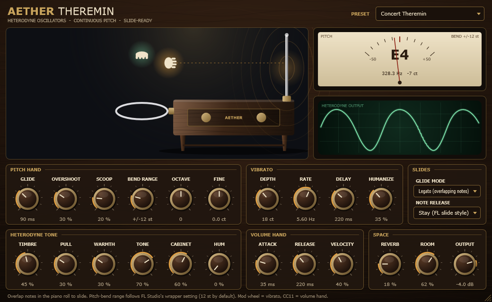

# Aether Theremin

A free, open-source theremin instrument plugin (VST3, plus a standalone app) built to sound like the real thing and to slide properly in **FL Studio**.



Listen: [concert theremin](docs/demo_concert_theremin.mp3) · [1950s sci-fi](docs/demo_1950s_sci-fi.mp3) · [808 glide](docs/demo_808_glide_theremin.mp3)

## Why it sounds like a theremin

Most "theremin" patches are a sine wave with portamento. Aether Theremin models how the instrument actually works:

- **Heterodyne oscillators.** A real theremin mixes two radio-frequency oscillators and you hear their difference frequency. The plugin models the two oscillators' phase difference directly.
- **Oscillator pulling.** The two oscillators are weakly coupled, so their phase difference follows *Adler's equation*. The plugin uses its exact solution. That's why low notes turn reedy and buzzy while high notes stay pure, just like on a real instrument. The model stays exactly in tune (tests measure every note within 0.1 cent).
- **Envelope detector.** The audio comes from envelope-detecting the summed RF signal. **Timbre** sets the oscillators' level ratio, which sweeps the sound from a pure sine to the bright, nasal "singing" tone.
- **Valve output stage and loudspeaker cabinet.** These add warmth (even harmonics that grow as you play louder) and the boxy, vocal colour of the instrument's built-in speaker. Optional mains hum and valve hiss add a vintage touch.
- **A human player.** Pitch moves like a hand: smooth S-curve glides with optional overshoot, and a small scoop up into fresh notes. Vibrato arrives a moment after the note starts, eases off while the pitch is travelling, and is never perfectly regular. Slow thermal drift and a little hand tremor complete it. The volume hand never re-attacks during a slide.

The oscillator runs at 4x oversampling, so bright settings stay alias-free across the whole range.

## Using it in FL Studio

1. Copy `Aether Theremin.vst3` into `C:\Program Files\Common Files\VST3`. If you built from source, run `install.bat`, which asks for administrator rights.
2. In FL Studio, open **Options > Manage plugins** and click **Find installed plugins**.
3. Add **Aether Theremin** from the plugin browser (it's listed under generators/instruments).

### Slides

| What you do in FL Studio | What the theremin does |
| --- | --- |
| **Overlap two notes** in the piano roll | The pitch slides to the new note without re-attacking. **Glide** sets the slide time. |
| Short note **on top of** a long note | Slides up and **stays** there until the long note ends (*Note Release: Stay*). This mirrors FL Studio's native slide notes. Switch to *Return* to glide back instead. |
| Notes that just touch (no overlap) | A fresh note. Slides happen only where notes really overlap, whatever order FL Studio sends the note-on and note-off in. |
| Want every note to glide? | Set **Glide Mode** to *Always*. |
| Pitch bend / **Channel pitch** knob automation | Smooth, de-zippered bends. |
| Note colours mapped to MIDI channels, or MPE controllers | Pitch bend is tracked per MIDI channel. |

**Pitch bend range:** FL Studio converts its pitch automation to MIDI pitch bend using the *Pitch bend range* in the plugin wrapper's settings, which defaults to **12 semitones**. The plugin's **Bend Range** also defaults to 12, so they match out of the box. If you change one, change the other. If you enable *Send pitch bend range* in the wrapper's MIDI settings, the plugin picks the value up automatically (RPN 0).

FL Studio's own slide-note flag only works with FL's native instruments. With any VST instrument, the reliable way to slide is to overlap the notes, which this plugin turns into a true theremin glide.

### Other controls

- **Mod wheel** adds vibrato depth.
- **CC11 (expression)** works as the volume hand, for swells drawn as automation.
- **Click and drag in the theremin picture** to play it with the mouse: nearer the antenna is higher, higher up is louder.
- **Resizable window.** It opens at a compact 728 x 448. Drag the grip in the bottom-right corner to make it any size and shape, from 416 x 256 up to 5200 x 3200. Everything scales sharply, and in a wider or taller window the theremin picture and the knob rows spread out to fill the space. Each project remembers its window size.
- **Presets:** Concert Theremin, FL Slide Lead, Pure Sine, 1950s Sci-Fi, Bright Reed, Vintage Radio, Ghost Choir, Deep Bass Theremin, 808 Glide Theremin. They appear in FL Studio's preset menu.

## Parameters

| Section | Controls |
| --- | --- |
| Pitch hand | Glide, Overshoot, Scoop, Bend Range, Octave, Fine |
| Vibrato | Depth, Rate, Delay, Humanize |
| Slides | Glide Mode (Legato / Always), Note Release (Stay / Return) |
| Heterodyne tone | Timbre, Pull, Warmth, Tone, Cabinet, Hum |
| Volume hand | Attack, Release, Velocity |
| Space | Reverb, Room, Output |

Every parameter can be automated.

## Building from source

**Windows** needs Visual Studio 2022 or newer (or the Build Tools) with the *Desktop development with C++* workload. CMake and Ninja are included.

```bat
build.bat
```

JUCE is downloaded automatically. To use an existing checkout, run `build.bat -DTHEREMIN_JUCE_PATH=C:\path\to\JUCE`. The plugin ends up in `build\AetherTheremin_artefacts\Release\VST3\`.

**Any platform** with CMake:

```sh
cmake -S . -B build -DCMAKE_BUILD_TYPE=Release
cmake --build build --config Release
```

macOS builds also produce an Audio Unit. The macOS build runs in CI, but it hasn't been tested on a Mac.

### Tests

```bat
build\tests\ThereminTests_artefacts\Release\ThereminTests.exe test-output
build\tests\ThereminHostTest_artefacts\Release\ThereminHostTest.exe "build\AetherTheremin_artefacts\Release\VST3\Aether Theremin.vst3"
```

- `ThereminTests` checks:
  - tuning at every range, timbre and sample rate;
  - slide behaviour, including same-timestamp note ordering;
  - pitch bend, per-channel bend and RPN;
  - controllers, click-free envelopes, and identical output under random buffer sizes;
  - presets, state save/restore and speed;
  - the editor's layout at seven window sizes, from the minimum to 2600 x 1600, including very wide and very tall shapes.

  It also writes demo WAVs and editor screenshots at each tested size.
- `ThereminHostTest` loads the compiled `.vst3` through the real VST3 interfaces, as a DAW does, and repeats the key checks there. It adds stress tests: random automation of every parameter, re-preparing at different sample rates and block sizes, zero-length buffers, and opening and closing the editor.

The GitHub Actions workflow builds Windows and macOS, runs both test programs, and validates the VST3 with [pluginval](https://github.com/Tracktion/pluginval) at strictness level 10.

## Project layout

```
Source/
  dsp/ThereminEngine.*     heterodyne voice, hand models, MIDI handling
  PluginProcessor.*        parameters, presets, state, host glue
  PluginEditor.*           window layout
  gui/                     look-and-feel and the playable theremin view
  Parameters.h, Presets.h  parameter definitions and factory presets
tests/                     offline tests and the VST3 host test
```

## License

Aether Theremin is released under the **GNU AGPL v3** (see [LICENSE](LICENSE)). It's built with [JUCE](https://juce.com), which is used under its AGPLv3 open-source licence. VST is a registered trademark of Steinberg Media Technologies GmbH.
